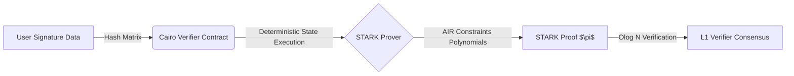

# Post-Quantum Signature Verification for STARK-Based Smart Contracts

## Overview

This repository establishes a World-Class Layer 0 Cryptographic Infrastructure to implement deterministic hash-based post-quantum signatures (WOTS+, XMSS) specifically optimized for STARK-based Zero-Knowledge execution environments (Cairo VM). 

By strictly utilizing symmetric hash assumptions and coalgebraic formal semantics, this framework eliminates the intractable ZK-PQC Gap associated with lattice-based architectures, securing long-horizon blockchain primitives natively against Universal Quantum Adversaries.

## System Architecture

## Quick Start (Deterministic Dev Environment)

This project strictly enforces deterministic reproducible environments. A one-click setup is available via DevContainers.

1. Ensure [Docker](https://www.docker.com/) and [VS Code](https://code.visualstudio.com/) are installed.
2. Install the `Dev Containers` extension in VS Code.
3. Open the repository in VS Code, and click **"Reopen in Container"** when prompted.
4. The container will automatically provision:
   - Ubuntu 22.04 Base
   - Cairo (Scarb) Toolchain
   - Rust Stable/Nightly Toolchain
   - Node.js (Husky/Linting Tooling)
   - LaTeX (Spec Compilation)

## Enterprise Governance

To maintain academic rigor and uncompromising software supply chain integrity, refer to the following:
- [CONTRIBUTING.md](./CONTRIBUTING.md) for strict GitFlow and PR standards.
- [SECURITY.md](./SECURITY.md) for vulnerability reporting arrays.
- [CODE_OF_CONDUCT.md](./CODE_OF_CONDUCT.md) for community interaction rules.

## License
Apache-2.0 License. See [LICENSE](./LICENSE) for details.
